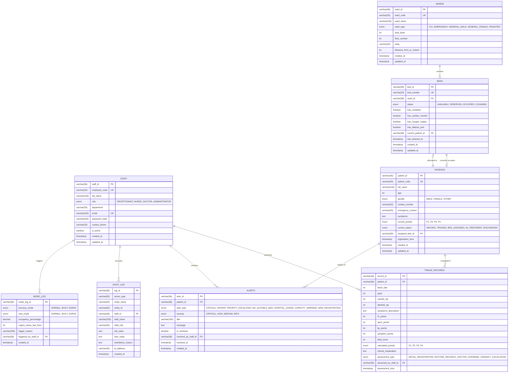

# Database Entity-Relationship (ER) Diagram
## AI-Enabled Hospital Resource and Emergency Triage System
**Course:** CSA1104 – Object Oriented Analysis and Design (OOAD)

---

### 1. Database Architecture
The relational database schema is designed for MySQL 8.0, fully normalized to Third Normal Form (3NF), ensuring ACID compliance, relational integrity, foreign key cascading constraints, and optimized indexing for emergency queries.

The architecture comprises eight core tables:
1. `staff`: Personnel credentials and Role-Based Access Control (RBAC).
2. `wards`: Hospital units, physical layout, and ER distances.
3. `beds`: Sanitization states, lifecycle, and specialized equipment telemetry.
4. `patients`: Demographics, chief complaints, current urgency priority, and admission state.
5. `triage_records`: Objective vital sign scores, mathematical factor breakdowns, and historical triage assessments.
6. `alerts`: Clinical alarms, deterioration alerts, and capacity threshold notifications.
7. `audit_log`: Immutable forensic trail for doctor overrides, status transitions, and administrative actions.
8. `mode_log`: History of operational hospital mode transitions (Normal $\leftrightarrow$ Busy $\leftrightarrow$ Surge).

---

### 2. Mermaid ER Diagram

---

### 3. Relational Schema & Constraints Summary

| Table | Primary Key | Foreign Keys | Key Constraints & Validation |
| :--- | :--- | :--- | :--- |
| `staff` | `staff_id` | — | `UNIQUE(employee_code)`, `UNIQUE(email)`, `role IN ('RECEPTIONIST', 'NURSE', 'DOCTOR', 'ADMINISTRATOR')` |
| `wards` | `ward_id` | — | `UNIQUE(ward_code)`, `total_beds > 0`, `distance_from_er_meters >= 0` |
| `beds` | `bed_id` | `ward_id` $\to$ `wards.ward_id`, `current_patient_id` $\to$ `patients.patient_id` | `UNIQUE(bed_number)`, `status IN ('AVAILABLE', 'RESERVED', 'OCCUPIED', 'CLEANING')` |
| `patients` | `patient_id` | `assigned_bed_id` $\to$ `beds.bed_id` | `UNIQUE(patient_code)`, `age BETWEEN 0 AND 130`, `current_priority IN ('P1','P2','P3','P4')` |
| `triage_records` | `record_id` | `patient_id` $\to$ `patients.patient_id`, `assessed_by_staff_id` $\to$ `staff.staff_id` | `hr_points, spo2_points, bp_points, symptom_points BETWEEN 0 AND 3`, `total_score BETWEEN 0 AND 12` |
| `alerts` | `alert_id` | `patient_id` $\to$ `patients.patient_id`, `resolved_by_staff_id` $\to$ `staff.staff_id` | `severity IN ('CRITICAL', 'HIGH', 'MEDIUM', 'INFO')` |
| `audit_log` | `log_id` | `staff_id` $\to$ `staff.staff_id` | Immutable append-only log; captures doctor overrides and state changes with mandatory reason |
| `mode_log` | `mode_log_id` | `triggered_by_staff_id` $\to$ `staff.staff_id` | Captures occupancy %, urgent arrival count, and trigger reason |
