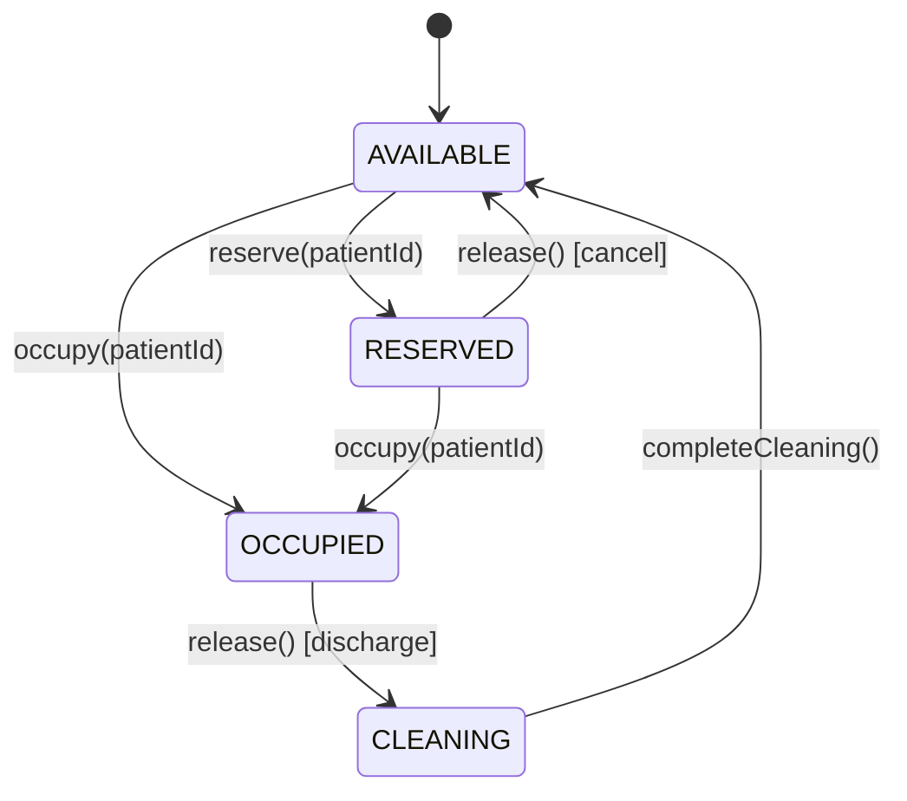
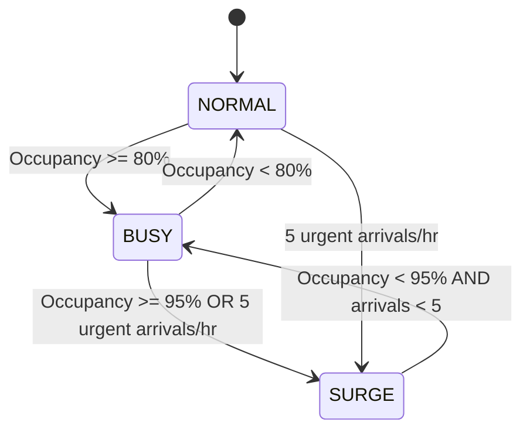
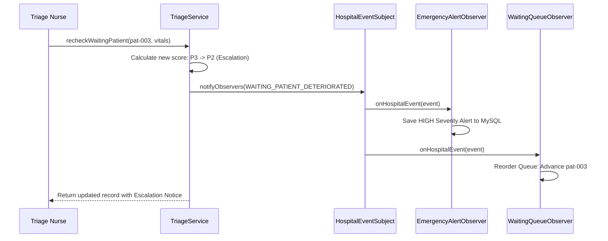

# OOAD Architectural & Design Patterns Report
## AI-Enabled Hospital Resource and Emergency Triage System
**Course:** CSA1104 – Object Oriented Analysis and Design (OOAD)  
**Author / Engineering Team:** Senior Full-Stack Software Engineering & Medical Informatics Architecture

---

## 1. Executive Summary & Academic Objective

In high-volume hospital emergency departments (EDs), clinical decision-making is severely constrained by acute patient surges, limited critical care beds, and cognitive fatigue. The objective of this project is to model, architect, and implement a robust, responsive web application that assists medical staff in:
1. Registering incoming emergency patients with automated ID generation.
2. Calculating multi-factor physiological triage priority scores.
3. Ranking and allocating specialized beds based on multi-criteria patient needs.
4. Monitoring hospital-wide operational capacity modes (Normal, Busy, Surge).
5. Detecting clinical deterioration during routine waiting room re-checks.
6. Enforcing clinical governance through audited Doctor Overrides.

### Key Clinical Governance Directive
> **Crucial Principle:** The system serves strictly as a **Clinical Decision Support System (CDSS)**. It is designed to augment and accelerate physician and nursing decision-making; it **must never replace professional medical judgement**.

---

## 2. SOLID Object-Oriented Principles Implementation

The architecture strictly adheres to the five SOLID design principles:

### 2.1 Single Responsibility Principle (SRP)
Each class in the system possesses one, and only one, reason to change:
- `TriageService`: Exclusively orchestrates patient vital examinations and score persistence.
- `BedService`: Exclusively manages bed allocation, ward queries, and equipment state.
- `StandardAITriageStrategy`: Exclusively encapsulates physiological point scoring rules.
- `WeightedMultiCriteriaBedStrategy`: Exclusively encapsulates the mathematical weighting algorithm for bed ranking.
- `HospitalModeContext`: Exclusively manages operational mode states.

### 2.2 Open/Closed Principle (OCP)
The software entities are **open for extension, but closed for modification**:
- The triage scoring engine defines the `TriageScoringStrategy` interface. When pediatric scoring (`PediatricTriageStrategy`) or specialized disaster mass-casualty triage rules are introduced, no existing scoring classes or services need to be edited. New strategies implement the interface and plug into the service dynamically.

### 2.3 Liskov Substitution Principle (LSP)
Objects of supertypes can be replaced with objects of subtypes without altering the correctness of the program:
- Any implementation of `TriageScoringStrategy` (`StandardAITriageStrategy`, `PediatricTriageStrategy`) can be substituted interchangeably inside `TriageService` without breaking score evaluation contracts.
- Any implementation of `BedState` (`AvailableBedState`, `OccupiedBedState`, `ReservedBedState`, `CleaningBedState`) can be passed to `BedStateContext`.

### 2.4 Interface Segregation Principle (ISP)
Clients should not be forced to depend upon interfaces they do not use:
- Rather than creating a monolithic `HospitalManager` interface, the system provides narrow, focused abstractions: `TriageScoringStrategy`, `BedRankingStrategy`, `BedState`, `HospitalModeState`, and `HospitalEventObserver`.

### 2.5 Dependency Inversion Principle (DIP)
High-level modules do not depend on low-level modules; both depend on abstractions:
- `TriageService` depends on the `TriageScoringStrategy` abstraction rather than directly coupling to concrete implementations.
- `BedService` depends on the `BedRankingStrategy` abstraction.
- Spring Boot's Dependency Injection (IoC Container) automatically wires interfaces to their configured implementations.

---

## 3. Detailed Analysis of Implemented GoF Design Patterns

### 3.1 The Strategy Pattern (Behavioral)
Used to encapsulate families of interchangeable algorithms:

#### Strategy A: Pluggable Triage Scoring (`TriageScoringStrategy`)
- **Context:** `TriageService`
- **Strategy Interface:** `TriageScoringStrategy`
- **Concrete Strategies:**
  1. `StandardAITriageStrategy`: Adult multi-factor emergency scoring model.
  2. `PediatricTriageStrategy`: Age-adjusted scoring with pediatric baseline normalizations (HR 80–120 bpm, adapted blood pressure ranges).

```
+--------------------------+
|  TriageScoringStrategy   | <<interface>>
+--------------------------+
| +calculateScore(...)     |
+--------------------------+
             ^
             |
    +--------+------------------------+
    |                                 |
+--------------------------+   +--------------------------+
| StandardAITriageStrategy |   | PediatricTriageStrategy  |
+--------------------------+   +--------------------------+
```

#### Strategy B: Multi-Criteria Bed Ranking (`BedRankingStrategy`)
- **Context:** `BedService`
- **Strategy Interface:** `BedRankingStrategy`
- **Concrete Strategy:** `WeightedMultiCriteriaBedStrategy`
- **Mathematical Formulation:**
  $$\text{Total Fit Score} = (0.40 \times S_{\text{priority}}) + (0.30 \times S_{\text{equipment}}) + (0.20 \times S_{\text{ward}}) + (0.10 \times S_{\text{distance}})$$

Where:
- $S_{\text{priority}} \in [0, 100]$: Evaluates clinical fit. A P1 patient receives $100\%$ in ICU and $95\%$ in ER, but only $40\%$ in general wards.
- $S_{\text{equipment}} \in [0, 100]$: Evaluates life-support readiness. Beds with ventilators ($45\%$), cardiac monitors ($35\%$), and piped oxygen ($20\%$).
- $S_{\text{ward}} \in [0, 100]$: Evaluates cohort suitability (Pediatric ward for patients age $<14$, gender-matching for general wards).
- $S_{\text{distance}} \in [0, 100]$: Normalized proximity to the Emergency Resuscitation Bay: $\max(20, 100 - (\text{meters} \times 0.5))$.

---

### 3.2 The State Pattern (Behavioral)
Used to allow an object to alter its behavior when its internal state changes:

#### State Machine A: Bed Sanitization & Allocation Lifecycle (`BedState`)
- **Context:** `BedStateContext`
- **State Interface:** `BedState`
- **Concrete States:** `AvailableBedState`, `ReservedBedState`, `OccupiedBedState`, `CleaningBedState`



- **Enforcement:** Prevents clinical errors such as admitting a patient to an un-sanitized bed or double-allocating an occupied bed by throwing `IllegalStateException`.

#### State Machine B: Hospital Operating Mode (`HospitalModeState`)
- **Context:** `HospitalModeContext`
- **State Interface:** `HospitalModeState`
- **Concrete States:** `NormalModeState`, `BusyModeState`, `SurgeModeState`



- **Operational Directives:**
  - `NORMAL`: Standard operating protocol; elective procedures permitted.
  - `BUSY`: Expedited discharge reviews, bed-cleaning fast track, on-call nursing alert.
  - `SURGE`: Code Red Surge protocol: non-trauma divert, mobilize disaster teams, convert step-down beds.

---

### 3.3 The Observer Pattern (Behavioral)
Used to define a one-to-many dependency between objects so that when one object changes state, all its dependents are notified automatically:

- **Subject:** `HospitalEventSubject`
- **Observer Interface:** `HospitalEventObserver`
- **Concrete Observers:**
  1. `EmergencyAlertObserver`: Instantiates and persists `Alert` entities to MySQL when `CRITICAL_PATIENT_ARRIVED`, `WAITING_PATIENT_DETERIORATED`, or `HOSPITAL_MODE_CHANGED` events occur.
  2. `WaitingQueueObserver`: Reacts to vitals deterioration during routine re-checks and dynamically recalculates waiting room priority order.
  3. `DashboardUpdateObserver`: Dispatches real-time updates for telemetry screens.



---

## 4. Academic Mathematical Formulation Summary

### 4.1 Triage Score Formula (0 to 12 Points)
$$\text{Total Score} = P_{\text{HR}} + P_{\text{SpO2}} + P_{\text{BP}} + P_{\text{Symptoms}}$$

Each physiological factor is mapped to an objective integer score $0 \le P_i \le 3$:

| Physiological Factor | 0 Points (Normal) | 1 Point (Mild) | 2 Points (Moderate) | 3 Points (Severe / Critical) |
| :--- | :--- | :--- | :--- | :--- |
| **Heart Rate ($P_{\text{HR}}$)** | $60 - 100\text{ bpm}$ | $50-59$ or $101-119$ | $40-49$ or $120-139$ | $<40$ or $\ge 140\text{ bpm}$ |
| **Oxygen SpO2 ($P_{\text{SpO2}}$)** | $\ge 95\%$ | $92 - 94\%$ | $88 - 91\%$ | $< 88\%$ |
| **Systolic BP ($P_{\text{BP}}$)** | $100 - 139\text{ mmHg}$ | $140-159$ or borderline | $160-179$ or $<90$ | $\ge 180$ or $<80\text{ mmHg}$ |
| **Symptoms ($P_{\text{Symptoms}}$)** | Minor / Ambulatory | Moderate Discomfort | Severe Distress / Pain | Life-Threatening (STEMI, Stroke, Arrest) |

#### Priority Classification Rules:
- **P1: Score 8 – 12** $\to$ **Critical**: Immediate resuscitation protocol.
- **P2: Score 5 – 7** $\to$ **High**: Urgent physician evaluation within 15 minutes.
- **P3: Score 3 – 4** $\to$ **Moderate**: Semi-urgent assessment within 60 minutes.
- **P4: Score 0 – 2** $\to$ **Low**: Non-urgent / routine ambulatory care.

### 4.2 Four-Hour Bed Occupancy Forecast Formula
$$\text{Projected Beds} = \min\left(C_{\text{total}}, \max\left(0, B_{\text{occupied}} + A_{\text{expected}} - D_{\text{expected}}\right)\right)$$

$$\text{Projected Occupancy \%} = \left(\frac{\text{Projected Beds}}{C_{\text{total}}}\right) \times 100\%$$

*Example from specification:*
$$42\text{ occupied} + 8\text{ expected admissions} - 4\text{ expected discharges} = 46\text{ projected occupied out of } 50\text{ beds} = 92.0\%$$
Since $92.0\% \ge 80.0\%$, the system automatically issues a **Capacity Warning Alert**.

---

## 5. Doctor Override Governance & Audit Trail

In clinical practice, atypical emergency presentations (such as silent myocardial infarction in diabetic patients with normal vitals or subtle subarachnoid hemorrhage) require immediate senior medical intervention that algorithms may under-prioritize.

The AegisHealth system incorporates an audited **Doctor Override Console** (`DoctorOverrideService`):
1. **RBAC Guard:** Restricted strictly to authenticated `DOCTOR` or `ADMINISTRATOR` roles.
2. **Mandatory Clinical Justification:** Requires explicit medical rationale (minimum 10 characters).
3. **Forensic Audit Logging:** Records:
   - Target Patient ID & Code
   - Old Priority vs New Physician Priority
   - Attending Doctor Name & Staff ID
   - Exact Timestamp & Originating IP Address
   - Mandatory Clinical Rationale
4. **Queue Re-sort:** Triggers Observer event to immediately adjust patient ranking.
