# UML Class Diagram
## AI-Enabled Hospital Resource and Emergency Triage System
**Course:** CSA1104 – Object Oriented Analysis and Design (OOAD)

---

### 1. Structural Overview
The system follows Clean Layered Architecture and implements three core GoF (Gang of Four) Object-Oriented Design Patterns:
1. **Strategy Pattern:** For pluggable Triage Scoring (`TriageScoringStrategy`) and Multi-Criteria Bed Allocation (`BedRankingStrategy`).
2. **State Pattern:** For Bed Lifecycle status management (`BedState`) and Hospital Operational Mode evaluation (`HospitalModeState`).
3. **Observer Pattern:** For asynchronous emergency alerts, queue urgency escalation, and real-time dashboard telemetry (`HospitalEventObserver`, `HospitalEventSubject`).

---

### 2. Mermaid UML Class Diagram

```mermaid
classDiagram
    direction TB

    %% =========================================================================
    %% DOMAIN ENTITIES
    %% =========================================================================
    class Patient {
        -String patientId
        -String patientCode
        -String fullName
        -Integer age
        -String gender
        -String contactNumber
        -String emergencyContact
        -String symptoms
        -TriagePriority currentPriority
        -PatientStatus currentStatus
        -String assignedBedId
        -LocalDateTime registrationTime
        -LocalDateTime createdAt
        -LocalDateTime updatedAt
        +getUrgencyScore() int
    }

    class Bed {
        -String bedId
        -String bedNumber
        -Ward ward
        -BedStatus status
        -Boolean hasVentilator
        -Boolean hasCardiacMonitor
        -Boolean hasOxygenSupply
        -Boolean hasDialysisPort
        -String currentPatientId
        -LocalDateTime lastCleanedAt
        +occupy(String patientId)
        +release()
        +clean()
    }

    class Ward {
        -String wardId
        -String wardCode
        -String wardName
        -WardType wardType
        -Integer totalBeds
        -Integer floorNumber
        -String wing
        -Integer distanceFromErMeters
    }

    class Staff {
        -String staffId
        -String employeeCode
        -String fullName
        -StaffRole role
        -String department
        -String email
        -String passwordHash
        -String contactPhone
        -Boolean isActive
    }

    class TriageRecord {
        -String recordId
        -Patient patient
        -Integer heartRate
        -Integer spo2
        -Integer systolicBp
        -Integer diastolicBp
        -String symptomsDescription
        -Integer hrPoints
        -Integer spo2Points
        -Integer bpPoints
        -Integer symptomPoints
        -Integer totalScore
        -TriagePriority calculatedPriority
        -String clinicalExplanation
        -AssessmentType assessmentType
        -String assessedByStaffId
        -LocalDateTime assessmentTime
    }

    class Alert {
        -String alertId
        -Patient patient
        -AlertType alertType
        -AlertSeverity severity
        -String title
        -String message
        -Boolean isResolved
        -String resolvedByStaffId
        -LocalDateTime resolvedAt
        -LocalDateTime createdAt
    }

    class AuditLog {
        -String logId
        -String actionType
        -String entityName
        -String entityId
        -String staffId
        -String staffName
        -String staffRole
        -String oldValue
        -String newValue
        -String mandatoryReason
        -String ipAddress
        -LocalDateTime createdAt
    }

    class HospitalModeLog {
        -String modeLogId
        -HospitalMode previousMode
        -HospitalMode newMode
        -Double occupancyPercentage
        -Integer urgentCasesLastHour
        -String triggerReason
        -String triggeredByStaffId
        -LocalDateTime createdAt
    }

    %% Entity Relationships
    Bed "1" *-- "1" Ward : located in
    Patient "0..1" -- "0..1" Bed : assigned to
    TriageRecord "*" --> "1" Patient : evaluated for
    Alert "*" --> "0..1" Patient : concerns
    AuditLog "*" --> "0..1" Staff : performed by

    %% =========================================================================
    %% STRATEGY PATTERN: TRIAGE & BED RANKING
    %% =========================================================================
    class TriageScoringStrategy {
        <<interface>>
        +getStrategyName() String
        +calculateScore(Patient patient, int hr, int spo2, int sysBp, int diaBp, String symptoms) TriageAssessmentResult
    }

    class StandardAITriageStrategy {
        +calculateScore(...) TriageAssessmentResult
        +calculateHeartRatePoints(int hr) int
        +calculateSpo2Points(int spo2) int
        +calculateBloodPressurePoints(int sys, int dia) int
        +calculateSymptomPoints(String desc) int
    }

    class PediatricTriageStrategy {
        -StandardAITriageStrategy standardStrategy
        +calculateScore(...) TriageAssessmentResult
    }

    TriageScoringStrategy <|.. StandardAITriageStrategy : implements
    TriageScoringStrategy <|.. PediatricTriageStrategy : implements
    PediatricTriageStrategy --> StandardAITriageStrategy : delegates

    class BedRankingStrategy {
        <<interface>>
        +getStrategyName() String
        +rankBedsForPatient(Patient patient, List~Bed~ candidateBeds) List~BedCandidateScore~
    }

    class WeightedMultiCriteriaBedStrategy {
        -double weightPriority
        -double weightEquipment
        -double weightWard
        -double weightDistance
        +rankBedsForPatient(Patient patient, List~Bed~ candidateBeds) List~BedCandidateScore~
        -evaluatePriorityFit(TriagePriority priority, Bed bed) double
        -evaluateEquipmentFit(TriagePriority priority, Bed bed) double
        -evaluateWardTypeFit(Patient patient, Bed bed) double
        -evaluateDistanceFit(Bed bed) double
    }

    BedRankingStrategy <|.. WeightedMultiCriteriaBedStrategy : implements

    %% =========================================================================
    %% STATE PATTERN: BED STATUS & HOSPITAL MODE
    %% =========================================================================
    class BedState {
        <<interface>>
        +getStatus() BedStatus
        +reserve(BedStateContext ctx, Bed bed, String patientId)
        +occupy(BedStateContext ctx, Bed bed, String patientId)
        +release(BedStateContext ctx, Bed bed)
        +completeCleaning(BedStateContext ctx, Bed bed)
    }

    class AvailableBedState {
        +reserve(...)
        +occupy(...)
        +release(...)
        +completeCleaning(...)
    }

    class ReservedBedState {
        +reserve(...)
        +occupy(...)
        +release(...)
        +completeCleaning(...)
    }

    class OccupiedBedState {
        +reserve(...)
        +occupy(...)
        +release(...)
        +completeCleaning(...)
    }

    class CleaningBedState {
        +reserve(...)
        +occupy(...)
        +release(...)
        +completeCleaning(...)
    }

    class BedStateContext {
        -BedState currentState
        +setState(BedState state)
        +reserve(Bed bed, String patientId)
        +occupy(Bed bed, String patientId)
        +release(Bed bed)
        +completeCleaning(Bed bed)
    }

    BedState <|.. AvailableBedState
    BedState <|.. ReservedBedState
    BedState <|.. OccupiedBedState
    BedState <|.. CleaningBedState
    BedStateContext o-- BedState

    class HospitalModeState {
        <<interface>>
        +getMode() HospitalMode
        +evaluateNextState(double occupancyPct, int urgentCasesLastHour) HospitalModeState
        +getOperationalDirective() String
    }

    class NormalModeState {
        +evaluateNextState(...) HospitalModeState
    }

    class BusyModeState {
        +evaluateNextState(...) HospitalModeState
    }

    class SurgeModeState {
        +evaluateNextState(...) HospitalModeState
    }

    class HospitalModeContext {
        -HospitalModeState currentState
        +updateMode(double occupancyPct, int urgentCasesLastHour) boolean
    }

    HospitalModeState <|.. NormalModeState
    HospitalModeState <|.. BusyModeState
    HospitalModeState <|.. SurgeModeState
    HospitalModeContext o-- HospitalModeState

    %% =========================================================================
    %% OBSERVER PATTERN: EMERGENCY ALERTS & QUEUE MONITORING
    %% =========================================================================
    class HospitalEventObserver {
        <<interface>>
        +getObserverName() String
        +onHospitalEvent(HospitalEvent event)
    }

    class EmergencyAlertObserver {
        -HospitalEventSubject subject
        -AlertRepository alertRepository
        +onHospitalEvent(HospitalEvent event)
    }

    class WaitingQueueObserver {
        -HospitalEventSubject subject
        -PatientRepository patientRepository
        +onHospitalEvent(HospitalEvent event)
    }

    class DashboardUpdateObserver {
        -HospitalEventSubject subject
        +onHospitalEvent(HospitalEvent event)
    }

    class HospitalEventSubject {
        -List~HospitalEventObserver~ observers
        +registerObserver(HospitalEventObserver o)
        +unregisterObserver(HospitalEventObserver o)
        +notifyObservers(HospitalEvent event)
    }

    HospitalEventObserver <|.. EmergencyAlertObserver
    HospitalEventObserver <|.. WaitingQueueObserver
    HospitalEventObserver <|.. DashboardUpdateObserver
    HospitalEventSubject o-- HospitalEventObserver : notifies

    %% =========================================================================
    %% SERVICE LAYER
    %% =========================================================================
    class PatientService {
        -PatientRepository patientRepository
        -TriageService triageService
        -HospitalEventSubject eventSubject
        +registerPatient(PatientRegistrationRequest req) Patient
        +getWaitingQueue() List~Patient~
    }

    class TriageService {
        -TriageScoringStrategy standardStrategy
        -TriageScoringStrategy pediatricStrategy
        -HospitalEventSubject eventSubject
        +assessPatient(TriageAssessmentRequest req) TriageRecord
        +recheckWaitingPatient(String patientId, VitalSignsRecheckRequest req) TriageRecord
    }

    class BedService {
        -BedRepository bedRepository
        -WeightedMultiCriteriaBedStrategy bedRankingStrategy
        +recommendBedsForPatient(String patientId) List~BedCandidateScore~
        +assignBedToPatient(String bedId, BedAssignRequest req) Bed
        +updateBedStatus(String bedId, BedStatusUpdateRequest req) Bed
    }

    class DoctorOverrideService {
        -PatientRepository patientRepository
        -AuditLogService auditLogService
        +applyDoctorOverride(DoctorOverrideRequest req) Patient
    }

    class HospitalModeService {
        -HospitalModeContext modeContext
        +evaluateAndSyncMode() HospitalMode
        +calculateForecast(Integer admissions, Integer discharges) BedForecastDTO
    }

    PatientService --> TriageService
    PatientService --> HospitalEventSubject
    TriageService --> HospitalEventSubject
    BedService --> WeightedMultiCriteriaBedStrategy
    DoctorOverrideService --> Patient
    HospitalModeService --> HospitalModeContext
```

---

### 3. Design Pattern Realization Table

| OOAD Design Pattern | Primary Interface | Concrete Implementations | Context / Orchestrator | Functional Role |
| :--- | :--- | :--- | :--- | :--- |
| **Strategy Pattern** | `TriageScoringStrategy` | `StandardAITriageStrategy`, `PediatricTriageStrategy` | `TriageService` | Computes 4-factor objective triage score (HR, SpO2, BP, Symptoms 0-3 pts) & assigns priority (P1-P4). |
| **Strategy Pattern** | `BedRankingStrategy` | `WeightedMultiCriteriaBedStrategy` | `BedService` | Ranks candidate beds using multi-criteria weighted scoring: 40% Priority + 30% Equipment + 20% Ward + 10% Distance. |
| **State Pattern** | `BedState` | `AvailableBedState`, `ReservedBedState`, `OccupiedBedState`, `CleaningBedState` | `BedStateContext` | Enforces medical sanitization and assignment lifecycle transitions. Prevents double-booking. |
| **State Pattern** | `HospitalModeState` | `NormalModeState`, `BusyModeState`, `SurgeModeState` | `HospitalModeContext` | Dynamically updates operating mode based on occupancy (&lt;80%, &ge;80%, &ge;95%) and hourly surge arrivals. |
| **Observer Pattern** | `HospitalEventObserver` | `EmergencyAlertObserver`, `WaitingQueueObserver`, `DashboardUpdateObserver` | `HospitalEventSubject` | Dispatches events when patients deteriorate, P1 arrives, or bed capacity triggers thresholds. |
